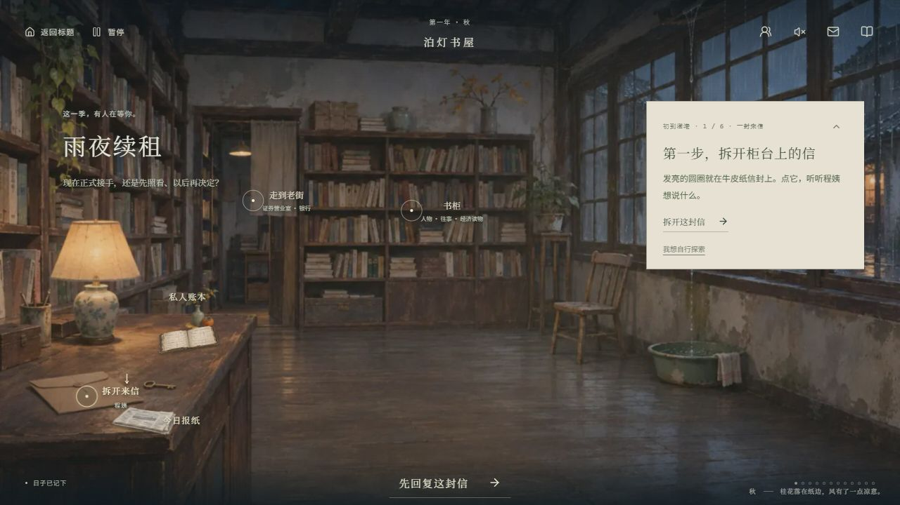
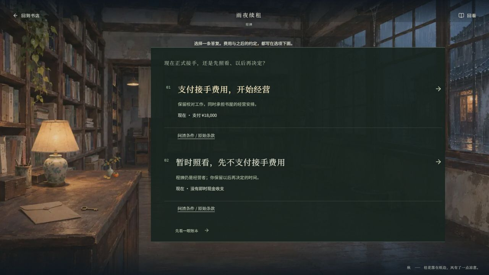
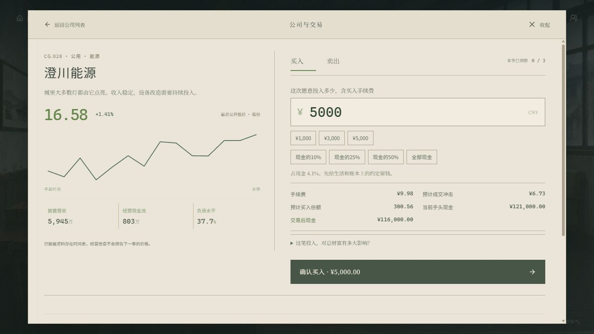
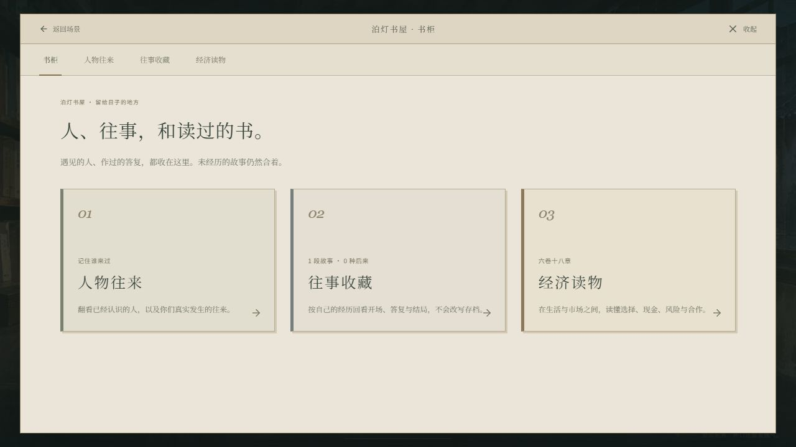
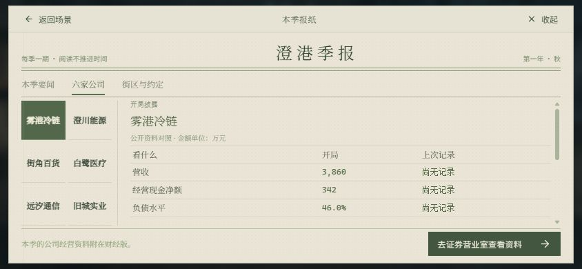
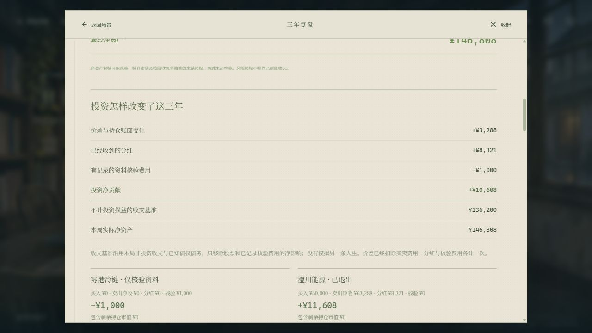
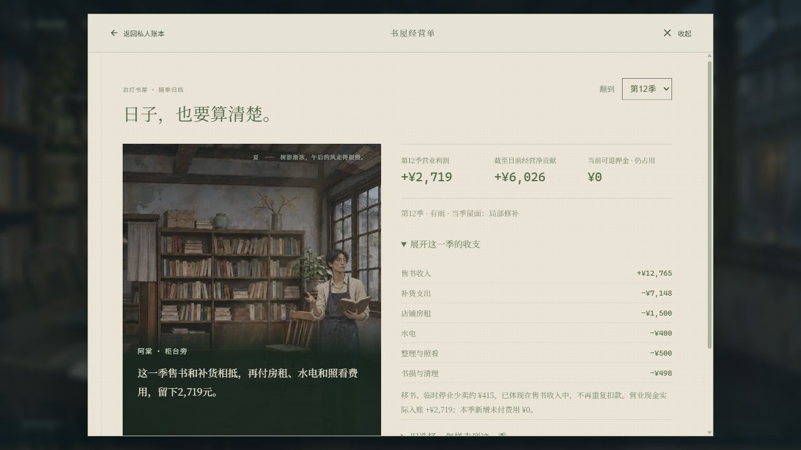
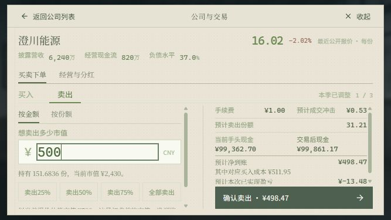

<div align="center">

# 均衡之渊 · Aequilibrium

**你有十二万元，也有还没答复的三年。**

一款关于投资、承诺与普通生活的中文叙事游戏。

### [立即游玩 ↗](https://winkiey.github.io/Aequilibrium/)

**https://winkiey.github.io/Aequilibrium/**

无需注册 · 浏览器自动存档 · 手机横屏 · 可下载离线资源

[](https://github.com/Winkiey/Aequilibrium/actions/workflows/ci.yml)




*澄港，初秋。楼下的书屋，即将有一位新的照看者。*

</div>

## 从一封来信开始

你在印刷厂做校对，租住在泊灯书屋楼上。程姨准备去南方学陶，留下钥匙，也留下还有三年的租约。接手书屋、继续工作、回应朋友的邀约，都需要钱，也需要时间。

市场每季变化，生活也不会停下来。有人带来一份未盖章的订单，有人等着周五晚上的一个座位。你可以买入一家公司，也可以把钱留到下次付款；你作出的答复，会走进之后的往来和三年后的结局。

## 在澄港怎样生活

- **读一段能回应的故事。** 人物逐句交谈，旁白与对白分开；上一回的答复会被记起，选择前可展开核对费用、日期与未知条件。
- **给钱找一个去处。** 到证券营业室读公司、比较披露、买卖股份；到银行办理借款与还款。卖出可按金额、份额或持仓比例选择，确认前看清净到账与盈亏。季报记录六家公司的已披露经营事项、尚待落实的条件和季末核验；回款、成本与融资变化会进入公司的经营和估值，报价仍有不确定性。可付费核验有日期与来源的附件，之后回看落实情况；经营现金会影响留存与分红，派息同时进行除息。
- **从第一笔小额买入学起。** 九步交易教学包含公司分析、并排比较与盈亏演算。价格上涨、不变、下跌，各自会留下什么结果，可以先试再决定。下单前还能核对仓位与总财富的关系；终局将价差、分红与核验成本合在一起，呈现投资真正留下的收益。
- **让书屋慢慢经营。** 押金与费用分开记，修缮、读者活动和共同轮值会留下后续收支。每季听阿棠说说这一季，再翻经营单；经营赚钱与收回全部投入，是两件需要分别核对的事。
- **留住人和往事。** 书柜收着人物往来、亲历故事、已达成结局与六卷经济读物。未选择的分支保持封存。
- **准备好，再翻日历。** 阅读和思考没有倒计时。结束本季才结算经营、工资、分红与到期约定。

十二季生活，七十六个事件，十二种结局。收益、关系和已经答应的事，共同决定这三年留下什么。

## 游戏画面

以下为浏览器内的实际游玩画面。

| 作出答复 | 安排资金 |
| --- | --- |
|  |  |
| 每份答复，都有要承担的事情 | 下单前，先看清钱会去哪里 |



*书柜收着相识的人、经历的故事，以及随时可以取下的阅读册。*



*每季一份，读公司也读城市。要闻、经营披露与街区往来，各有可以翻阅的版面。*



*账上留下的回报，既有报价的起落，也有持有期间收到的现金。*



*一季的售书、雨损与照看费用，都有可以翻回去核对的记录。*

## 手机横屏

书屋的账本、报纸、书柜与出门入口固定在画面下方。交易时，左侧选择金额，右侧核对费用、净到账与盈亏；确认按钮始终留在可见区域。长篇资料可在各自阅读区内翻阅。



## 开始游玩

打开 **[在线版](https://winkiey.github.io/Aequilibrium/)**，选择从雨夜开始。第一次可以先下载完整资源包，也可以直接在线进入。资源包包含游戏入口、运行时画面、字体和现有片头，提供进度、暂停、重试与完整性检查。支持的浏览器可将游戏添加到桌面或主屏幕。

进度保存在当前浏览器，可在暂停菜单导出、导入。手机请横屏。离线资源下载不等于存档备份；清理站点数据前请导出进度。资源缓存可能被浏览器清理，图片解码和设备性能也会影响加载体验。离线与安装细节见 [离线说明](docs/OFFLINE.md)。

**已经在玩，想更新版本？** 在原来游玩的同一浏览器打开 **[游戏更新页](https://winkiey.github.io/Aequilibrium/update/)**，选择“保存进度并更新”。新版资源校验完成后即可继续原来的日子。若提示还有其他游戏页面，关闭那些窗口，只保留更新页后重试。之后也可从游戏的标题或暂停菜单检查更新。详见 [更新说明](docs/UPDATES.md)。

## 本地运行

需要 **Node.js 22.13+**。

```sh
npm ci
npm run dev
```

默认地址为 `http://127.0.0.1:5173`。`/playtest` 使用独立进度，方便从头体验。

```sh
npm run typecheck
npm test
npm run build:pages
```

`dist-pages/` 是 GitHub Pages 静态产物；主分支变更由现有工作流发布。离线包在静态构建时生成，开发服务器不会注册缓存。原 Worker 构建入口仍为 `npm run build`。结构与贡献说明见 [开发文档](docs/DEVELOPMENT.md)。

## 阅读与素材

书柜的经济读物提供六卷十八章，涵盖选择与时间、市场与信息、经营与资金、判断与风险、信用与制度、物价与共同生活。正文、生活例子与原文短引分别标注，出处见 [阅读资料](docs/READING_SOURCES.md)。

美术采用写实手绘电影分镜风格。场景、人物姿态、季节素材的来源与制作记录见 [美术方向](docs/ART_DIRECTION_V2.md) 和 [素材清单](docs/ASSET_MANIFEST.json)。中文字体使用 Noto Serif SC，许可见 [OFL](public/fonts/OFL.txt)。项目整体尚未指定开源许可证。
