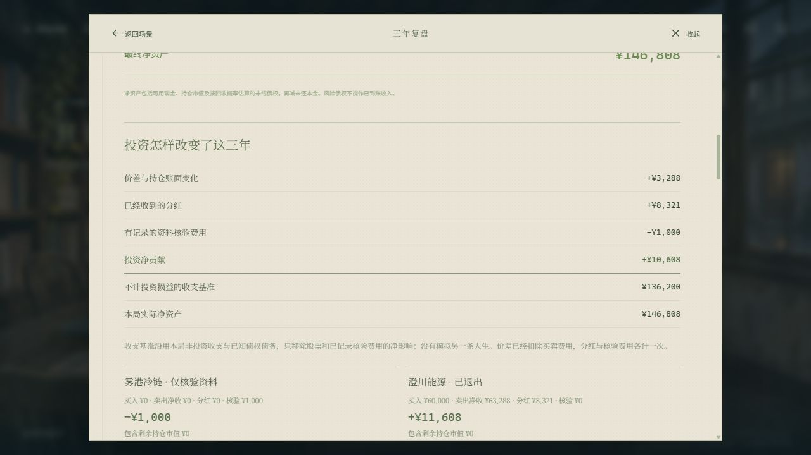
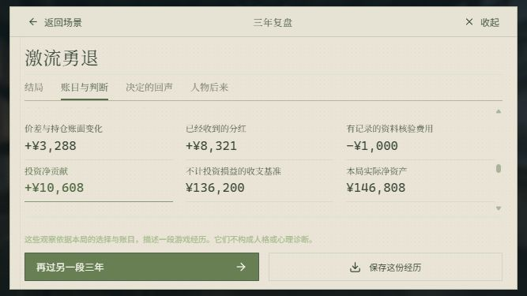

# 判断、持有与回报

2026-11-09 · 市场机制第二批

这次让投资形成实际财富差异，同时把判断依据与收益核算补齐。书店经营规则、生活收支、剧情现金奖励、结局条件和既有演出保持原有范围；不靠削减工资、放大来信惩罚或统一提高波动来制造投资的重要性。

## 玩家会遇到什么

1. 公司版与营业室可以核验本季附件，费用在点击前标明。文件记录季度、材料来源、文件状态、覆盖比例、公开财务与尚未确定的条件。同一家公司同一季的相同材料只收一次费用，剧情中的相应核验共用档案。核验不会花掉交易次数，也不会提高下一季的好运。
2. 五处既有付费研究（主线第九季、冷库空位、门店扩张、通信合同、重看买价）会交付文件，答复演出完成后再打开资料。正文与原答复不拼接重播。历史已经付过的钱不会反向补造档案或重新收费。
3. 合同或报价的状态与覆盖范围，是这一季开始时固定的世界条件。公开新闻仍可免费阅读；核验进一步缩小不确定性，但不会揭露未来完成结果、经营冲击或下一季报价。街角百货未披露同店拆分，文件明确这一缺口，不编造数据。
4. 下单前可以查看成交后仓位、剩余现金、临近已约定付款，以及这笔份额假设涨跌10%会影响多少财富。教学仍从小额练习开始，金额由玩家决定；投入比例低时，收益对整笔积蓄的影响也会低。
5. 季末把相关公司的当时材料、计划落实、经营变化、每份派息和除息放在一起核对。公司资料按季度保存已核验文件与实际分红，下一季不会覆盖旧文件。
6. 复盘新增投资贡献：价差和剩余持仓、收到的分红、已记录核验费各算一次。已退出公司的胜率也按总回报计算，避免价差亏损但分红后盈利仍被记为失败。同一家公司多次进出合并，不是逐笔交易胜率。

## 财富为何会不同

市场v2已经让实际营收、现金转换与负债进入估值，但没有充分累积盈利公司创造并留在企业内的现金。持有者主要等待快照估值的修正，投资回报因而容易被生活与剧情现金流淹没。

市场v3把这一季可归属于股份的经营现金作为独立现金资本：产生现金，增加企业资本；发生经营净流出，减少资本。现金资本随季度留存，影响之后的估值。报价仍包含宏观环境、估值修正和外部冲击，有好财报也可能下跌。个人买卖通过手续费、滑点影响成交，不改变公司的营收、合同完成与基础报价路径。

具体数值是游戏尺度：每份生成额为“参考股价 × 本季经营现金 / 参考营收 × 0.26 × 行业可留存系数”。行业系数为冷链0.55、能源0.65、零售0.65、医疗0.70、通信0.40、实业0.35。它用于映射企业再投入与股份回报，不是现实财务估值公式。

只有正的当期现金且累积现金资本覆盖前期缺口后，才有可分配额。负债达到70%时不派息，55%至70%之间降低派息比例；较低负债时能源分配可分配额的55%，其他公司35%。股息从报价与留存资本中同时扣除，持有份额对应的实际派息进入现金流水。不能让“分红到账”和“不变的股价”重复创造财富；负债偿付也不等于账户余额。

起点¥120,000不自动扩大仓位，不保证长期持有或某家公司盈利。持有回报、投入比例和损失承受能力都需要玩家选择。

## 同本金的版本对照

种子1—200，每局十二季，初始积蓄¥120,000。每种策略使用相同的非经营主线、续章、生活收支，不借款，不作可选日常；全部支付第九季核验费¥700。固定投入¥10,000、¥30,000、¥60,000分别比较。所有季度存档经过validateSave，交易真实扣费、冲击和分红；终局尚持股份计入假设卖出成本。

“长期持有”仅指开局买能源；“分散持有”指能源、零售、冷链等额买入；“公开轮动”每季按当时事项与财务规则选公司，下一季退出；“随机轮动”使用相同交易频率随机选择公司。没有读取隐藏条件、未来价格或挑选有利种子。这些是固定政策实验，不是所有玩家胜率或最佳策略搜索。

投入¥60,000时的终局实际净资产均值：

| 策略 | 上一版v2 | 当前v3 | 当前相对相同收支持币局 |
| --- | ---: | ---: | ---: |
| 长期持有 | ¥142,093.16 | ¥154,273.21 | +¥18,773.21 |
| 分散持有 | ¥140,928.84 | ¥151,257.74 | +¥15,757.74 |
| 公开轮动 | ¥141,732.14 | ¥150,825.72 | +¥15,325.72 |
| 随机轮动 | ¥132,402.58 | ¥138,095.62 | +¥2,595.62 |
| 不买股票 | ¥135,500.00 | ¥135,500.00 | — |

当前长期持有投资净贡献均值+¥18,073.21，分散+¥15,057.74，公开轮动+¥14,625.72，随机+¥1,895.62。这里各扣了¥700核验费；旧版把这笔钱列在来信支出中，因此跨版本比较采用实际财富，不能直接混比旧投资分类。当前现金策略也支付相同核验费，其投资净贡献为−¥700，实际财富并未改变。

当前长期持有终局最低¥124,418.86，投资净亏¥11,781.14；公开轮动最低¥91,284.76，投资净亏¥44,915.24；随机最低¥90,562.57。长期持有正收益187/200并不代表任意公司、任意仓位或任意故事路线的概率。分散持有平均回撤4.94%，单一能源持有7.13%。小额¥10,000长期持有的投资净贡献均值仍只有+¥2,480.57；本金规模对整局收益影响保留，不要求玩家为了让投资“重要”而满仓。

另以500种子、每季¥10,000轮动重跑公开资料实验：事项加财报均值+¥2,216.03，仅财报+¥2,224.84，随机−¥131.07，持币−¥700。事项加财报相对随机的配对均值+¥2,347.11；相对仅财报−¥8.81，近似95%区间[−205.83,+188.21]。这条固定规则未显示“多看一条新闻就一定提高收益”；不能用实验宣传付费材料必然赚钱。该实验没有购买附件，核验信息的策略价值尚未单独标定。

完整方法、样本范围、源码指纹与分布见[收益实验](RETURNS_BENCHMARK.json)。运行：

```sh
node scripts/benchmark-wealth.mjs 200
node scripts/benchmark-wealth.mjs 200 /path/to/previous/source
node scripts/benchmark-market.mjs 500
```

第二条的旧源来自已发布0f7eaf315dc8ef12099d096d6d1f0cb858ad9c76，两个版本顺序运行，避免共用隔离模块目录。脚本不读取玩家存档。

## 旧进度与账目

存档键名与外层版本不变。旧市场当前季度先完整按原版完成，下一季才接入v3，以迁移时实际公司数字作为新参考点；不重算价格、持仓、历史派息、债务、承诺或旧对白。已结束的游戏只使用新的报告算法读取原账目，不重开结算。

复盘中的“不计投资损益的收支基准”是实际财富减去投资净贡献的算术对照，沿用本局的其他收支与未结债权债务，没有模拟另一种人生。已知研究费从来信支出移入投资成本，不能两处扣除。旧档没有对应档案的费用保留历史分类，不猜测或回填。

全现金买入还修正了一处分币舍入：以实际手续费核算最大可成交预算，避免一分钱溢出导致“全部现金”被拒绝。原有成交记录不改写。

## 范围与验证

本批没有新增季中报价、隐藏结局、流动性专属事件、服务器随机源或视频。纯本地单机中的种子与规则仍可被技术手段分析，不宣称仅凭存档无法预测未来。继续优先解决正常玩家的判断依据与实际反馈。

自动检查覆盖同一份材料去重、剧情研究、资料存档与非法费用、未来结果隔离、含股息总回报、除息、负债和前期亏损对派息的约束、金额与仓位、旧v1/v2结算黄金夹具，以及既有全部结局的合法路径。类型检查、完整测试、Pages和Worker构建均须在发布前通过。真实浏览器跑局记录另记在本文的验收附录。

## 真实浏览器验收

使用原生IAB，在全新端口5186的独立/playtest从标题开始，完成首信、九步公司分析和首单、十二季主线及四段续章，最终读完整个结局。不是把脚本模拟称为人工跑局。未触碰正式存档，未挑选种子。

新周目seed310581455：首季买能源¥60,000，第十一季全部卖出；其余主线选第二项，第九季付费核验选第一项，续章均第二项，无借款、担保或虚构流水，不作可选日常。第一季另外在季报核验冷链¥300，重复打开两次、跨季度归档未重复收费。第九季核验¥700，在选择后第二句刷新，再继续同一句并完成文件交付，金额仅扣一次。

终局《激流勇退》，实际净资产¥146,808.28；投资净贡献+¥10,608.28＝卖出价差+¥3,287.58＋分红¥8,320.70−核验¥1,000。其余收支基准¥136,200，工作与生活净结余¥12,000，剧情与承诺净收支¥4,200。1次买入、1次卖出，回撤8.7%。单局不是平均结果：第四季有明显上涨，第八至十季连续回落，未以付费调查换来必涨。导出的真实存档通过validateSave。

手机844×390、667×375和默认桌面检查文件来源、返回上级、教学衔接、金额/份额/比例卖出、交易回单、派息除息、季末核验和终局分解。核验材料进入公司资料时，教学继续按步骤推进；只核验而未买入的公司标为“仅核验资料”。手机下单的仓位说明可在下单区展开，复盘六项收益数据在同一视图。

还在原5184独立试玩旧档（seed324101757）上真实经过原更新页升级。更新前后导出的game与collection深度比较相同，validateSave通过，净资产仍¥135,935.82，投资净收益¥435.82。两只完全退出的公司价差合计−¥127.05，加已收分红¥562.87后为正；旧价差口径0%改为总回报口径100%，没有重算一笔旧账或补造资料。

本批289项测试、类型检查、Pages与Worker构建通过，十二种结局的既有合法路线全部重放通过。旧v1、v2当前季度结算分别与上一版真实引擎生成的黄金夹具比较。书店结算代码逐字保持原有公式，不重构投入或经营选项。没有声称四种风格都人工通关；多风格采用同种子引擎实验，人工完整跑的是上述一局，另做旧终局升级兼容。




